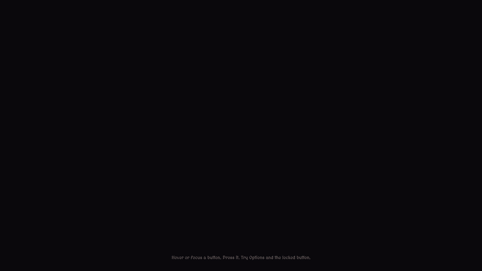
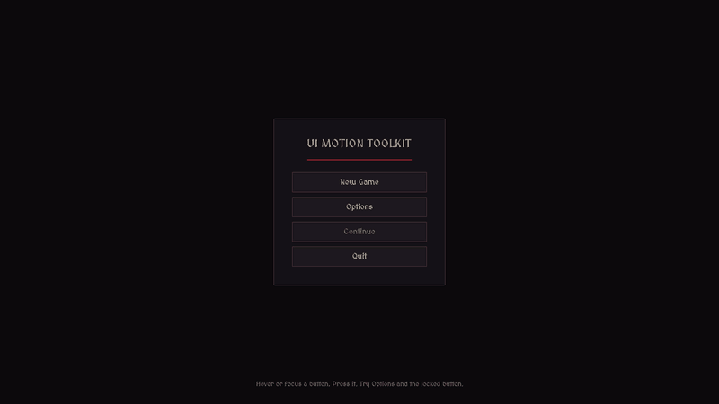
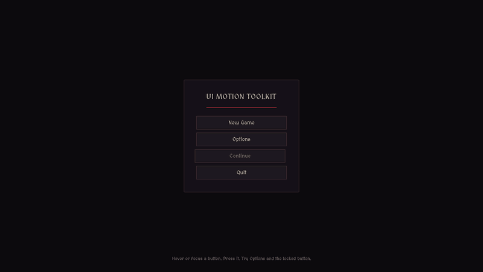
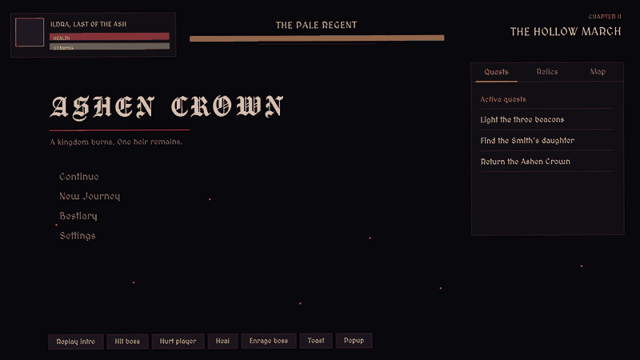
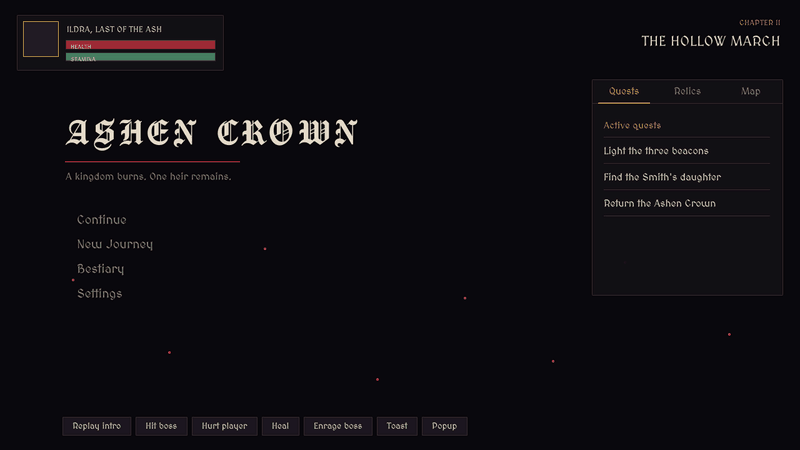
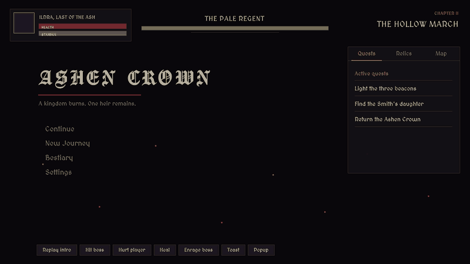
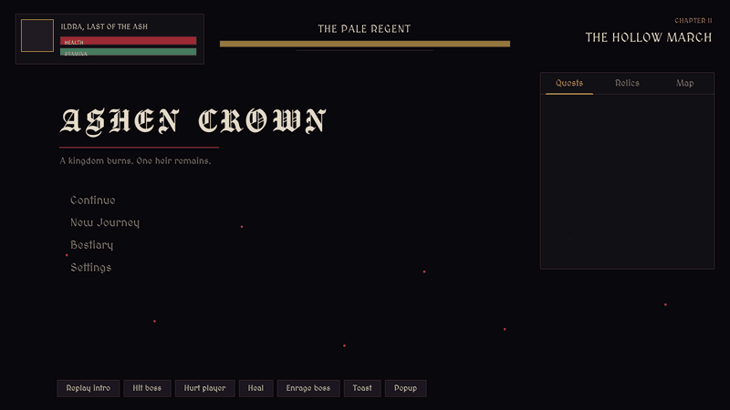

# UI Motion Toolkit

**Timeline-authored animation for Unity UI Toolkit.** Design a motion once in the Timeline window (or write it from code), then play, reverse, toggle, show and hide it on any `VisualElement` by id. No `PlayableDirector` per screen, no component per element, no tween library to learn.


```csharp
UIMotion.Show(menu, "Menu.Show");                       // reveal + animate in
UIMotion.Toggle(button, "Button.Focus", on: true);      // reversible state (hover, focus, selected)
UIMotion.Play(button, "Button.Press");                  // one-shot
UIMotion.Hide(menu, "Menu.Show", "Menu.Hide");          // animate out, then hide
```

> **Status:** 1.0.0. Developed and tested on **Unity 6000.6.0f1**. The core only uses long-standing UI Toolkit APIs (`style.translate/scale/rotate/opacity`, `usageHints`), but other Unity 6 versions are untested: please report what you find.

---

## Table of contents

1. [What it is](#what-it-is)
2. [Features](#features)
3. [Install](#install)
4. [Quick start (5 minutes)](#quick-start-5-minutes)
5. [How it is designed](#how-it-is-designed)
6. [Repository layout](#repository-layout)
7. [Samples](#samples)
8. [Pros and cons](#pros-and-cons)
9. [Documentation](#documentation)
10. [Tests](#tests)
11. [License and third-party notices](#license-and-third-party-notices)

---

## What it is

UI Toolkit has USS transitions for simple state changes, and the community [UI Toolkit Timeline](https://github.com/mihakrajnc/UITTimeline) package to animate elements with Timeline. Neither answers a common production need: *"I want a designed, multi-element choreography that I can author visually, retune without touching code, and trigger from gameplay code on any screen, any number of times, forward or backward."*

UI Motion Toolkit is a small runtime player and authoring layer on top of those clips:

- A **motion** is a normal Timeline asset. Each track is named after a **selector** (`#title`, `.menu-item`, `#panel .row`) and animates the elements it matches inside a **scope** you choose at play time. One asset serves every card, button or toast.
- A **library** maps motion ids (the asset names) to assets, so game code only knows strings, not asset references.
- The **player** (`UIMotion`) evaluates motions directly, without a `PlayableGraph`, on **unscaled time**, so menus keep moving while the game is paused.

## Features

- **Selector-driven tracks**: `#id`, `.class`, `#a .b`, `a > b`, `a, b`, `:scope`. The track name *is* the selector; text after `|` is a free label.
- **Clips**: position, scale, rotation, opacity, class, display, visibility (from UI Toolkit Timeline) plus **color** (background, image tint, text, border) and **noise shake** (added by this package).
- **Eased in/out weights** per clip, including overshoot curves (back ease) for springy entrances.
- **Stagger** on any track, forward or reverse: lists and menus cascade with one number.
- **Three playback styles**: one-shot `Play` (optionally looped), reversible `Toggle`, presence `Show`/`Hide`.
- **Channels**: a new playback in a busy channel replaces the previous one; independent channels run together (focus + press + loop on the same element).
- **Reversal without pops**: `Toggle(off)` plays backward from the current time.
- **Authoring from code** (editor): a fluent `MotionAsset` builder (`FadeIn`, `MoveFrom`, `Pop`, `ColorPulse`, `Shake`...) generates ordinary Timeline assets you can still edit by hand.
- **Timeline window preview** with the same evaluation code as the runtime.
- **Offscreen preview renderer** (editor): capture frames of a motion at chosen times, handy for docs and regression checks.
- **Deterministic evaluation**: the same time always gives the same frame (scrubbing, reversing, capturing).
- Works on `UIDocument` roots and on elements you build at runtime. Inline styles written by a motion are **cleared when it ends**, so your USS stays the single source of truth for rest states.

## Install

UI Motion Toolkit depends on two packages:

| Dependency | Why | How it is installed |
| --- | --- | --- |
| `com.unity.timeline` | Timeline assets and window | Resolved automatically by the Package Manager |
| [`dev.krajnc.uitoolkittimeline`](https://github.com/mihakrajnc/UITTimeline) (MIT) | The position/scale/rotation/opacity/class/display/visibility clips | **Manually, once** (Unity packages cannot declare Git dependencies) |

**1. Add UI Toolkit Timeline**: Package Manager > `+` > *Install package from git URL...*

```
https://github.com/mihakrajnc/UITTimeline.git
```

**2. Add UI Motion Toolkit**: Package Manager > `+` > *Install package from git URL...*

```
https://github.com/Delaruno20/ui-motion-toolkit.git
```

Or edit `Packages/manifest.json`:

```json
{
  "dependencies": {
    "dev.krajnc.uitoolkittimeline": "https://github.com/mihakrajnc/UITTimeline.git",
    "com.delaruno20.ui-motion-toolkit": "https://github.com/Delaruno20/ui-motion-toolkit.git"
  }
}
```

**3. (Optional) Import a sample**: Package Manager > *UI Motion Toolkit* > *Samples* > Import.

## Quick start (5 minutes)

**1. Create the library.** `Tools > UI Motion Toolkit > Rebuild Default Motion Library` creates `Assets/Resources/UI/UIMotionLibrary.asset` (the place `UIMotion` looks by default) and fills it with every motion timeline in your project. Re-run it whenever you add motions.

**2. Author a motion.** In the Project window: `Create > Timeline`, name it `Menu.Show`. Open it in the Timeline window (`Window > Sequencing > Timeline`), right-click the empty track area and add a **UIMotionTrack**. Rename the track with a selector, e.g. `.menu-item`, and add clips to it (opacity, position, scale, color...). Set **Stagger** on the track for a cascade.

Prefer code? The same motion as a generated asset (Editor script):

```csharp
using UIMotionToolkit;
using UIMotionToolkit.Editor;
using UnityEditor;
using UnityEngine;

public static class MyMotions
{
    [MenuItem("Tools/My Game/Build Motions")]
    public static void Build()
    {
        MotionAsset m = MotionAsset.Begin("Assets/Motions/Menu.Show.asset");
        m.Track(":scope").FadeIn(0, 0.35).MoveFrom(new Vector2(0, 28), 0, 0.5, MotionEase.OutCubic);
        m.Track(".menu-item", stagger: 0.07f)
            .FadeIn(0.3, 0.3)
            .MoveFrom(new Vector2(-48, 0), 0.3, 0.45, MotionEase.OutCubic);
        m.Save();
        UIMotionLibraryBuilder.RebuildDefault();
    }
}
```

**3. Play it.** The element you pass is the **scope**: selectors resolve inside it.

```csharp
using UIMotionToolkit;
using UnityEngine;
using UnityEngine.UIElements;

public class MenuController : MonoBehaviour
{
    void Start()
    {
        var root = GetComponent<UIDocument>().rootVisualElement;
        var menu = root.Q("menu");

        UIMotion.Show(menu, "Menu.Show");                                       // entrance
        UIMotionTriggers.BindAll(root, ".menu-item", "Item.Focus", "Item.Press"); // hover/focus + press feedback
    }
}
```

**4. Keep your USS honest.** A motion animates *toward or away from* the USS state; it never owns it. Write the rest look in USS (`.menu-item:focus { translate: 10px 0; }`) and make the end of the matching state motion equal it. See [the guide](Documentation~/UserGuide.md#the-rest-state-contract).

## How it is designed

```
                AUTHORING (editor)                            RUNTIME
  ┌──────────────────────────────────────┐     ┌──────────────────────────────────────────┐
  │ Timeline window   or   MotionAsset   │     │  game code                               │
  │ (visual)               (fluent code) │     │  UIMotion.Show / Toggle / Play / Hide    │
  └───────────────┬──────────────────────┘     └──────────────────┬───────────────────────┘
                  ▼                                               ▼
        TimelineAsset "Menu.Show"                          UIMotionLibrary  (id → asset)
        └ UIMotionTrack ".menu-item"                                │
          └ clips (opacity, position, color, shake...)              ▼
                  │                                        CompiledMotion  (plain data, no PlayableGraph)
                  └─────────────────────────────────────────────────┤
                                                                    ▼
                                                  UIMotionPlayback  (time, direction, loop, channel)
                                                                    ▼
                                                  MotionEvaluator   (selectors → elements, accumulate, write once)
                                                                    ▼
                                                  inline styles on VisualElements (cleared at the end)
```

Design decisions worth knowing:

| Decision | Consequence |
| --- | --- |
| **No `PlayableDirector` at runtime.** A timeline is *compiled* once into plain data (tracks → clip groups) and evaluated by `MotionEvaluator`. | Any root, any number of simultaneous instances of the same asset, forward or reversed, no GameObject per animation. |
| **The Timeline window uses the same evaluator** (`UIMotionDirectorMixer`). | What you scrub is exactly what plays. |
| **Track name = selector; scope chosen at play time.** | One "card" motion serves every card; a screen motion targets `#names`. |
| **Numeric clips are offsets from neutral**, weighted by their ease curves; all tracks add up on an element and the element is **written once per frame**. | A move, a fade and a shake on the same element combine instead of fighting. |
| **Inline styles are cleared when a playback ends.** | USS owns the rest state; no stale values, no "what set that opacity?". |
| **Reversible states** (`Toggle`) keep one playback per element and channel, and reverse from the current time. | Fast hover on/off never pops. |
| **Unscaled time**, per-frame delta clamped to 0.1 s. | Works under `Time.timeScale = 0` (pause menus); a hitch does not skip an animation. |
| **Missing motion is not an error for the UI.** | The state changes instantly, a warning is logged once. |
| **Deterministic shake** (Perlin noise keyed by time and seed). | Scrubbing and reverse playback are stable. |

Static state is limited to the active-playback list and the channel registry; it is reset on domain reload (`RuntimeInitializeOnLoadMethod`), so *Enter Play Mode Options* with disabled domain reload are safe.

## Repository layout

```
ui-motion-toolkit/
├── package.json                    UPM manifest (name, version, dependencies, samples)
├── README.md                       you are here
├── CHANGELOG.md
├── LICENSE.md                      MIT
├── THIRD-PARTY-NOTICES.md          fonts and dependencies shipped or required
│
├── Runtime/                        assembly UIMotionToolkit.Runtime
│   ├── Core/                       public API
│   │   ├── UIMotion.cs               static entry point: Play / Toggle / Show / Hide / Stop / Complete / Tick
│   │   ├── UIMotionPlayback.cs       one running playback: time, direction, speed, loop, events
│   │   ├── UIMotionLibrary.cs        ScriptableObject: motion id → TimelineAsset
│   │   ├── UIMotionTriggers.cs       wire focus / hover / press events to motions
│   │   └── UIMotionSelector.cs       the USS-like selector subset used by track names
│   ├── Evaluation/                 internal engine (no public surface)
│   │   ├── CompiledMotion.cs         Timeline asset → plain tracks / clip groups
│   │   └── MotionEvaluator.cs        binds selectors, accumulates offsets, writes styles, restores
│   ├── Timeline/                   Timeline integration
│   │   ├── UIMotionTrack.cs          the track (selector name, stagger, usage hints)
│   │   ├── UIMotionColorClip.cs      color clip
│   │   ├── UIMotionShakeClip.cs      shake clip
│   │   └── UIMotionDirectorMixer.cs  lets the Timeline window preview a motion
│   └── Components/                 MonoBehaviours
│       ├── UIMotionRunner.cs         hidden ticker (play mode, unscaled time)
│       └── UIMotionPreviewScope.cs   selects the scope for Timeline-window previews
│
├── Editor/                         assembly UIMotionToolkit.Editor (editor only)
│   ├── Authoring/UIMotionAuthoring.cs   MotionAsset / MotionTrackBuilder / MotionEase
│   ├── Library/UIMotionLibraryBuilder.cs  collect timelines into a library (+ menu item)
│   ├── Menus/UIMotionMenu.cs            "Create Preview Director"
│   └── Preview/UIMotionPreviewRenderer.cs offscreen frame capture
│
├── Tests/Editor/                   assembly UIMotionToolkit.Tests.Editor (18 EditMode tests)
├── AI~/ui-motion-toolkit/SKILL.md  instruction file for AI assistants
├── Samples~/                       imported on demand from the Package Manager
│   ├── BasicMenu/                  small, readable: start here
│   └── AdvancedShowcase/           a full game-style screen
└── Documentation~/
    ├── UserGuide.md                the complete guide
    └── Images/                     GIFs used in the docs
```

Reading order for a code review: `UIMotion.cs` (API) → `UIMotionPlayback.cs` (time) → `CompiledMotion.cs` → `MotionEvaluator.cs` (the interesting part) → `UIMotionAuthoring.cs`.

## Samples

Both samples use **pure USS art** (no textures) and the open-licensed fonts *MedievalSharp* and *Manufacturing Consent* (SIL OFL 1.1). Open the scene inside the sample folder and press Play. Every motion in them was generated by the editor script in the sample's `Editor/` folder: open any asset in the Timeline window to study it.

### Basic Menu (`Samples~/BasicMenu`, 8 motions)

Staggered entrance, reversible hover/focus, press pulse, error shake, popup show/hide, a fake loading cycle using `Hide` + callback + `Show`.

| Entrance | Popup | Error shake |
| --- | --- | --- |
|  |  |  |

### Dark Fantasy Showcase (`Samples~/AdvancedShowcase`, 24 motions)

A game-style screen: choreographed 3.5-second intro (26 tracks), seamless ambient loop, HUD bars with damage trail, hit / heal / critical-loop feedback shared by every bar, boss card with an *enrage* reversible state, a tabbed journal with direction-aware page transitions, a popup with a staggered sequence, and toasts built at runtime with chained one-shots. Click the stage during the intro to skip it (`UIMotion.Complete`). The bottom bar triggers each effect.

| Intro (26 tracks) | Hurt: stage shake + flash | Boss card |
| --- | --- | --- |
|  |  |  |

| Popup | Page transition |
| --- | --- |
|  |  |

## Use it with an AI assistant

[`AI~/ui-motion-toolkit/SKILL.md`](AI~/ui-motion-toolkit/SKILL.md) is a single self-contained instruction file that teaches an AI assistant the whole API, the authoring rules and the common pitfalls. It needs **no Unity access and no MCP**: the assistant writes the USS, an editor builder script and a runtime script, and you paste them in.

- **Claude** (web, free or paid): paste the file into a chat, or add it to a Project; in Claude Code or Claude with Skills, drop the `ui-motion-toolkit` folder in your skills directory.
- **ChatGPT, DeepSeek, Gemini, others**: paste the file as the first message (or into custom instructions / a custom GPT), then describe the UI you want animated.

The file is under 200 lines so it fits free-tier context limits.

## Pros and cons

**Pros**

- **Visual authoring, code-free playback.** Motion designers can tune curves and timing in Timeline while code only references ids.
- **One asset, many instances.** Selector tracks + play-time scope: no per-element components, no duplicated animations per card.
- **No `PlayableDirector`/GameObject per animation**: motions are evaluated directly, can run on runtime-built elements and in any number of copies.
- **Reversible states done right.** `Toggle` reverses from the current time; hover/focus flicker does not pop.
- **Plays correctly while paused** (unscaled time) and is deterministic when scrubbed or captured.
- **USS stays in charge.** Inline values are cleared at the end of every playback.
- **Everything composes**: several tracks (and several channels) can drive the same element; the result is written once per frame.
- **Code authoring generates plain assets**, so generated motions are reviewable, diff-able in the Timeline window, and hand-editable.
- **Small, readable code base** (about 2,300 lines), covered by EditMode tests.

**Cons / limitations (read before adopting)**

- **Extra dependency you install by hand:** *UI Toolkit Timeline* (MIT) cannot be declared as a Git dependency in a package manifest, so installation is two steps.
- **UI Toolkit only.** Nothing for uGUI/Canvas.
- **Transform properties are absolute while a motion runs.** `translate`, `scale` and `rotate` are written as *offset from zero / one / zero*, replacing any USS value for the duration. The rest state must be reproduced by the *end* of the matching motion (documented contract, easy once you know it; see the guide).
- **Position, scale and rotation do not animate layout** (`translate`/`scale`/`rotate` only). No animation of width/height/margins, flex values or arbitrary USS properties. Colors: background, image tint, text, border.
- **No spring physics, no value-driven bindings.** It plays authored timelines; it does not tween arbitrary fields or follow a target.
- **Playbacks are bound when they start.** Elements added to the scope after that need `playback.Bind()` (or a new play).
- **Global static player.** There is one `UIMotion` registry per domain; there is no per-panel player instance.
- **The offscreen preview renderer uses reflection** on Unity internals (`UIElementsRuntimeUtility`) and may break on future Unity versions. It is an editor convenience, not required at runtime.
- **Generated timelines are a build step.** After changing a builder script you must re-run it and rebuild the library (or call `UIMotionLibraryBuilder`); there is no auto-sync.
- **Only tested on Unity 6000.6.0f1.** No benchmarks have been published; measure on your own target hardware.
- **Sample art is intentionally plain** (USS only) so the package can be shared freely; you will want to skin it with your own assets.

## Documentation

- **[User Guide](Documentation~/UserGuide.md)**: every concept, API, selector rule, clip, pattern, and troubleshooting entry in detail.
- C# API comments are written to be read in the IDE; start with `UIMotion`.

## Tests

EditMode tests live in `Tests/Editor`. Unity only runs tests of packages listed under `testables`: add `"testables": ["com.delaruno20.ui-motion-toolkit"]` to your `Packages/manifest.json`, then *Window > General > Test Runner > EditMode*.

## License and third-party notices

- Code: **MIT** (see [LICENSE.md](LICENSE.md)).
- The samples bundle two fonts under the **SIL Open Font License 1.1** (OFL files are included next to each font). Details in [THIRD-PARTY-NOTICES.md](THIRD-PARTY-NOTICES.md).
- Requires *UI Toolkit Timeline* by Miha Krajnc (MIT), installed separately, and Unity's *Timeline* package.
- This package does **not** include any third-party UI art. (An earlier plan to illustrate the samples with a commercial UI kit was dropped because that kit's license forbids redistributing its files in a public repository.)
